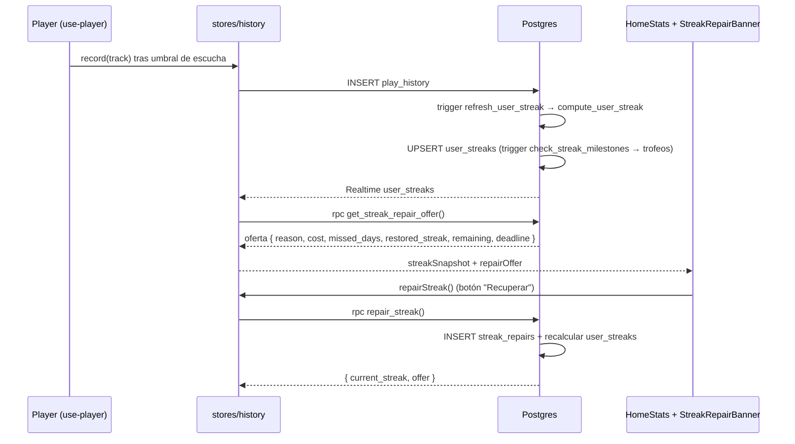

# Racha de escucha (streak) + recuperación

> Días LOCALES consecutivos con al menos una escucha. Calculada en la BD por trigger, mostrada en Home con estados por hora, y recuperable con **5 intentos al mes** si se pierde un día.

## Resumen de reglas

| Regla | Valor |
|---|---|
| Día que cuenta | Día **local** del usuario (`profiles.timezone`, fallback UTC) con ≥ 1 fila en `play_history` **o** recuperado en `streak_repairs` |
| Racha actual | Cuenta hacia atrás desde hoy (si ya escuchó) o desde ayer |
| Tope de seguridad | 3650 días (antes 365) |
| Intentos de recuperación | **5 por mes calendario** (tz del perfil), no se acumulan |
| Coste | **1 intento por día faltante** (hueco de 3 días = 3 intentos) |
| Plazo | Hasta **48 h** después de terminar el último día faltante (falta el lunes → se puede recuperar hasta el miércoles inclusive) |
| Hueco máximo | 5 días (más que eso no es recuperable) |
| Modo | **Manual**: el usuario pulsa "Recuperar" |

## Flujo



## Backend

### Cálculo — `compute_user_streak(user_id)`
- Devuelve `(streak_days, played_today)`.
- Día activo = `_streak_day_active(user, día, tz)`: play ese día local **o** fila en [[streak_repairs]].
- `played_today` mira **solo** `play_history` (un día recuperado no es "ya escuché hoy"); lo usa [[streak-reminder]] para decidir si avisar.
- Lo invoca el trigger `play_history_refresh_streak` (`refresh_user_streak()`) en cada INSERT de `play_history`, que hace UPSERT de `user_streaks` (`current_streak`, `longest_streak`, `longest_at`, `last_played_date`).

> [!important] La racha NO es un número editable
> `user_streaks.current_streak` se recalcula desde el historial en cada play. Editarlo a mano dura hasta la siguiente canción. Para cambiar una racha hay que cambiar los **días activos** (`play_history` o `streak_repairs`).

### Trofeos — `check_streak_milestones()`
Trigger en `user_streaks`: al cruzar 3, 7, 14, 30, 60 … 365, 500, 730, 1000 inserta en `streak_milestones` (el cliente muestra el toast por Realtime). También se disparan al **recuperar** una racha.

### Oferta — `get_streak_repair_offer()` (RPC, `authenticated`)
Cálculo puro sobre `auth.uid()` (envuelve `_streak_repair_offer(uuid)`):

1. Intentos usados este mes = filas de `streak_repairs` con `used_at` en el mes actual (tz del usuario). `remaining = 5 - usados`.
2. Racha en curso: termina hoy (si hoy activo) o ayer; se busca su primer día → `último día faltante = inicio - 1` (o ayer si no hay racha en curso).
3. Si `hoy - último faltante > 2` → `reason: 'none'` (no hay nada reciente que recuperar o venció el plazo).
4. Se mide el hueco hacia atrás hasta encontrar la racha anterior. Hueco > 5 → `gap_too_long`.
5. `restored_streak = racha anterior + hueco + racha en curso`.
6. `reason: 'ok'` si `remaining >= cost`, si no `not_enough`.

Respuesta:

```json
{ "available": true, "reason": "ok", "cost": 1, "missed_days": ["2026-10-11"],
  "previous_streak": 10, "restored_streak": 11, "remaining": 5,
  "monthly_limit": 5, "deadline": "2026-10-13" }
```

### Recuperar — `repair_streak()` (RPC, `authenticated`)
- `pg_advisory_xact_lock` por usuario (dobles taps / varios dispositivos).
- Revalida la oferta en la BD; si no está disponible lanza `streak_repair_unavailable: <reason>`.
- Inserta un día por fila en `streak_repairs`, recalcula `user_streaks` con `last_played_date = último día activo` (play o recuperado), y devuelve `{ current_streak, offer }`.
- El cliente **no** puede escribir `streak_repairs` directamente (RLS solo lectura del dueño). Los helpers `_streak_*` están revocados para `anon`/`authenticated`.

## Cliente

### Store — [[history]]
- `streakSnapshot`: fila de `user_streaks` (carga al login + Realtime).
- `repairOffer`: respuesta de `get_streak_repair_offer()`; `null` si no hay sesión/red.
- `loadRepairOffer()`: se llama tras `loadStreakSnapshot`, en cada evento Realtime de `user_streaks` y al volver la app a primer plano (`visibilitychange`, desde el banner).
- `repairStreak()`: llama a `repair_streak`, actualiza `repairOffer` y el snapshot de forma optimista; si falla recarga la oferta. Devuelve `true/false`.

### Estados de la tarjeta — `lib/streak-state.js` `selectStreakState()`

| Estado | Cuándo | Visual |
|---|---|---|
| `inactive` | Sin actividad ni récord | Gris, motas tenues |
| `fulfilled` | Ya escuchó hoy | Naranja vivo, chispas |
| `calm` | No escuchó hoy, < 12 h | Naranja suave |
| `danger` | 12–18 h | Halo azul, temblor |
| `urgent` | 18–23 h | Temblor + ceniza |
| `last-hour` | 23–24 h | Cuenta atrás MM:SS |
| **`paused`** | Rota pero `repairOffer.reason === 'ok'` | **"Racha en pausa · Recupérala abajo"**, muestra `previous_streak`, llama atenuada que respira lento |
| `broken` | Rota y no recuperable | Gris + humo, "Empieza de nuevo" |

`paused` solo sustituye a `broken`: si el usuario ya escuchó hoy después del hueco, la tarjeta muestra `fulfilled` y el banner sigue debajo.

### Banner — `components/Home/StreakRepairBanner.jsx`
Debajo de las cards de `HomeStats`:

- `reason: 'ok'` → "Recupera tu racha de N días · Faltaste el domingo, 11 oct. Cuesta 1 intento · te quedan 5 de 5 este mes. Disponible hasta el martes, 13 oct." + botón **Recuperar** (toast "¡Racha recuperada! N días").
- `reason: 'not_enough'` → variante gris informativa: "…te quedan R intentos. Se renuevan el 1 de <mes>."
- Otros (`none`, `gap_too_long`) → no se muestra.

## Operación / mantenimiento

### Diagnosticar una racha perdida
```sql
-- Días locales con escuchas (últimos 25 días)
select (played_at at time zone 'America/Caracas')::date d, count(*)
from play_history where user_id = '<uuid>' and played_at > now() - interval '25 days'
group by 1 order by 1;

select * from user_streaks where user_id = '<uuid>';
select * from compute_user_streak('<uuid>');
```
Los huecos en la lista de días son los que rompieron la racha.

### Restaurar a mano (soporte)
Preferir **insertar en `streak_repairs`** los días faltantes (no ensucia historial ni horas) y luego forzar el recálculo con un play o replicando el UPSERT de `repair_streak()`. Restauraciones antiguas (2026-07 y 2026-10-11) se hicieron con filas marcadoras en `play_history` (`source='restore'`, título "(racha restaurada)", 180 s) — siguen siendo válidas pero suman 3 min de escucha cada una.

### Probar sin tocar cuentas reales
1. Usar la cuenta de servicio (`servidor@ritmiq.org`): insertar plays de N días seguidos con un día faltante y ajustar `user_streaks` (`last_played_date` al último día con play).
2. Abrir la PWA con su sesión (Playwright con viewport de iPhone y `timezoneId` igual al del perfil) y comprobar banner → Recuperar → tarjeta.
3. Limpiar: `delete` de `streak_repairs`, `streak_milestones`, `hour_milestones`, `play_history` y `user_streaks` de esa cuenta.

Para la lógica SQL basta una transacción con `rollback` y `set_config('request.jwt.claims', '{"sub":"<uuid>","role":"authenticated"}', true)` para simular `auth.uid()`.

## Qué puede romper este cambio

| Cambio | Síntoma observable |
|---|---|
| Quitar `streak_repairs` de `_streak_day_active` | Las rachas recuperadas vuelven a romperse en el siguiente play |
| `played_today` contando días recuperados | `streak-reminder` deja de avisar aunque el usuario no haya escuchado hoy |
| `repair_streak` sin revalidar la oferta | Se podrían gastar intentos fuera de plazo o recuperar huecos > 5 días |
| No actualizar `last_played_date` al recuperar | La tarjeta sigue mostrando la racha como rota tras recuperar |
| Calcular el mes en UTC | Los intentos se renuevan horas antes/después del día 1 local |

## Archivos

- `supabase/migrations/20260524000001_user_streaks.sql` — `user_streaks` + trigger.
- `supabase/migrations/20260810000000_streak_tz_and_milestones.sql` — fix timezone + trofeos cada 30 días.
- `supabase/migrations/20261012000000_streak_repairs.sql` — recuperación + tope 3650.
- `packages/ui/src/stores/history.js` — `streakSnapshot`, `repairOffer`, `loadRepairOffer`, `repairStreak`.
- `packages/ui/src/lib/streak-state.js` — estados (incl. `paused`).
- `packages/ui/src/components/Home/HomeStats.jsx` / `StreakRepairBanner.jsx`.

Ver [[Decisiones-Tecnicas-ADR|ADR-038]], [[streak_repairs]], [[streak-reminder]], [[history]].

## Notas / Changelog
- 2026-10-12: recuperación de racha (5 intentos/mes, 1 por día, 48 h), estado `paused` en la tarjeta, tope 3650 días. Restaurada la racha del owner a 152 días (huecos del 29-sep, 5-oct y 7-oct).
